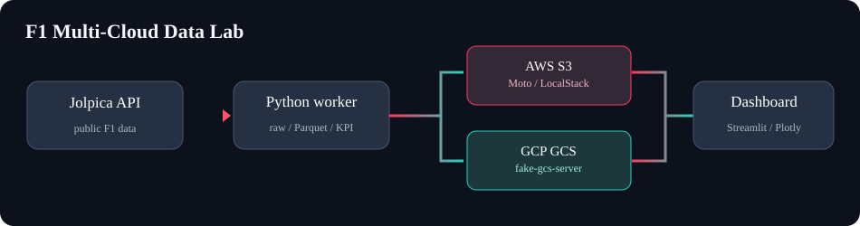

# F1 Multi-Cloud Data Dashboard

Proyecto **local** para practicar Data Engineering con dos SDKs cloud. No necesita cuenta AWS/GCP ni credenciales reales.



## Arrancar (Docker Desktop)

```bash
cp .env.example .env
docker compose up -d --build
```

Abrir **http://localhost:8501**. La primera ingesta es automática; espera a que el worker complete la descarga:

```bash
docker compose logs -f worker
```

La temporada inicial es **2025**. Para otra temporada, usa el selector del dashboard y pulsa **Actualizar desde Jolpica**. También puedes configurar `F1_SEASON=2024` en `.env` y reiniciar el worker.

Si no tienes conexión o la API está temporalmente indisponible, en la barra lateral usa **Modo demo → Cargar datos demo**. Ese dataset está marcado como **ficticio** en toda la UI.

## Qué ofrece

- KPI: carreras disputadas, pilotos, constructores, resultados y frescura.
- Clasificación de pilotos **oficial** desde Jolpica; puntos por equipos **solo carreras, no sprints**.
- Victorias, evolución de puntos por ronda, resultados de cada carrera, CSV descargables.
- Dos opciones de lectura real: `boto3 → S3 (Moto)` y `google-cloud-storage → GCS (fake-gcs-server)`.
- Verificación de SHA-256 de los Parquet; detección de *drift* entre clouds.
- Ingesta programada cada `SYNC_INTERVAL_HOURS` horas y actualización visual cada minuto.
- Snapshot/manifest de calidad publicado al **final** de la subida a cada cloud.
- RAW completo paginado, Silver Parquet y Gold JSON.

## Arquitectura

```text
               Jolpica API
                   |
          worker Python (6 h)
                   |
            normalize/Parquet
                   |
          +--------+--------+
          |                 |
   boto3 -> S3          GCS SDK -> GCS
     Moto/LocalStack     fake-gcs-server
          |                 |
          +--------+--------+
                   |
       Streamlit: KPIs / charts
       parity / freshness / QA
```

Objetos por cloud:

```text
f1-data-lake/
  raw/races/season=2025/run=.../page-0000.json
  raw/results/season=2025/run=.../page-0000.json
  raw/driverstandings/season=2025/run=.../page-0000.json
  silver/races/season=2025/run=.../races.parquet
  silver/results/season=2025/run=.../results.parquet
  silver/standings/season=2025/run=.../standings.parquet
  gold/season=2025/run=.../summary.json
  _control/season=2025/latest.json
```

Los blobs de `raw/`, `silver/` y `gold/` conservan versiones inmutables. `_control/latest.json` señala el snapshot confirmado de cada temporada (commit atómico por cloud). La ingesta se extrae **una sola vez** para evitar cargar dos veces la API; después se envían los **mismos bytes** a ambas nubes.

## Comandos útiles

```bash
# Ingesta de datos reales bajo demanda
docker compose exec dashboard python -m f1lab.cli --season 2025

# Demo totalmente offline (¡ficticio!)
docker compose exec dashboard python -m f1lab.cli --season 2025 --demo

# Ver logs
 docker compose logs -f worker

# Cerrar sin borrar el volumen GCS
docker compose down

# Eliminar GCS persistido; Moto ya pierde su estado al reiniciar
docker compose down -v
```

**Importante:** Moto guarda el estado de S3 **solo en memoria**. Si recreas/reinicias el contenedor `aws-mock`, el worker volverá a poblarlo en la siguiente ejecución o mediante el botón **Actualizar**. GCS conserva objetos en un volumen Docker. Si necesitas persistencia real en AWS local, usa LocalStack con el token que requieren sus versiones recientes, o un almacén S3 compatible persistente como MinIO.

## Integrarlo con tu LocalStack actual

En `.env` agrega:

```dotenv
AWS_ENDPOINT_URL=http://host.docker.internal:4566
```

Mantén LocalStack iniciado con tu `docker-compose` anterior. Esta versión **no** inicia LocalStack ni necesita contraseña AWS. `host.docker.internal` se resuelve desde los contenedores; en Linux está configurado `host-gateway` en Compose. El contenedor Moto permanecerá disponible, pero el cliente `boto3` apuntará a tu LocalStack.

Desde marzo de 2026 las imágenes actuales de LocalStack requieren **cuenta de LocalStack + auth token** (hay plan Hobby gratuito no comercial). Moto no requiere registro. Ninguna de las dos opciones necesita cuenta de AWS.

## Terraform opcional para S3/SQS

Existe `infra/aws/main.tf` para ensayar infraestructura AWS. Terraform **no es necesario** para arrancar: por simplicidad, el worker crea los buckets con los SDKs si aún no existen.

Si deseas gestionar el bucket con Terraform, levanta primero los emuladores **sin el worker**:

```bash
docker compose up -d aws-mock gcp-mock
cd infra/aws
terraform init
terraform apply
cd ../..
docker compose up -d --build
```

Si el bucket ya existe, impórtalo antes del `apply`:

```bash
cd infra/aws
terraform import aws_s3_bucket.f1_data_lake f1-data-lake
```

El recurso SQS está provisionado a efectos de laboratorio, pero **no forma parte del flujo** de esta versión; puede incorporarse en la siguiente iteración junto con Pub/Sub.

## Configuración

| Variable | Valor por defecto | Propósito |
|---|---|---|
| `F1_SEASON` | `2025` | Temporada programada por el worker |
| `SYNC_INTERVAL_HOURS` | `6` | Cada cuántas horas realizar ingesta |
| `AWS_ENDPOINT_URL` | `http://aws-mock:5000` | Endpoint S3 emulado (cambia a LocalStack) |
| `AWS_S3_BUCKET` | `f1-data-lake` | Bucket AWS |
| `GCS_BUCKET` | `f1-data-lake-gcp` | Bucket GCP |
| `STORAGE_EMULATOR_HOST` | `http://gcp-mock:4443` | Endpoint GCS |

**No publiques AWS_ACCESS_KEY_ID reales** en `.env` si estás usando los emuladores. En el proyecto las credenciales AWS son dummy: `test/test`.

## Tests

Con Python 3.11–3.13:

```bash
python -m venv .venv
source .venv/bin/activate
pip install -r requirements.txt pytest
PYTHONPATH=src pytest -q
```

Verificaciones en los tests: estructura normalizada, ausencia de duplicados, demo sin Internet, Parquet legible y SHA idénticos entre las dos nubes (stores en memoria).

## Límites de esta versión

- Infraestructura **emulada local**, no despliegue a cuentas AWS/GCP reales.
- Moto y fake-gcs-server emulan solo parte de los servicios de sus proveedores.
- Sin streaming, Pub/Sub, event triggers, BigQuery ni Athena (siguiente fase).
- Sin acceso a telemetría FastF1 todavía; los datos actuales se extraen de Jolpica.
- No hay garantía transaccional entre dos clouds: cada cloud usa un manifest como commit y se expone el estado divergente si uno falla.
- El dashboard no ofrece login y está pensado para uso **local**; no lo expongas públicamente sin añadir autenticación.

Fuentes: [Jolpica](https://github.com/jolpica/jolpica-f1/blob/main/docs/README.md), [Moto](https://docs.getmoto.org/), [fake-gcs-server](https://github.com/fsouza/fake-gcs-server).
